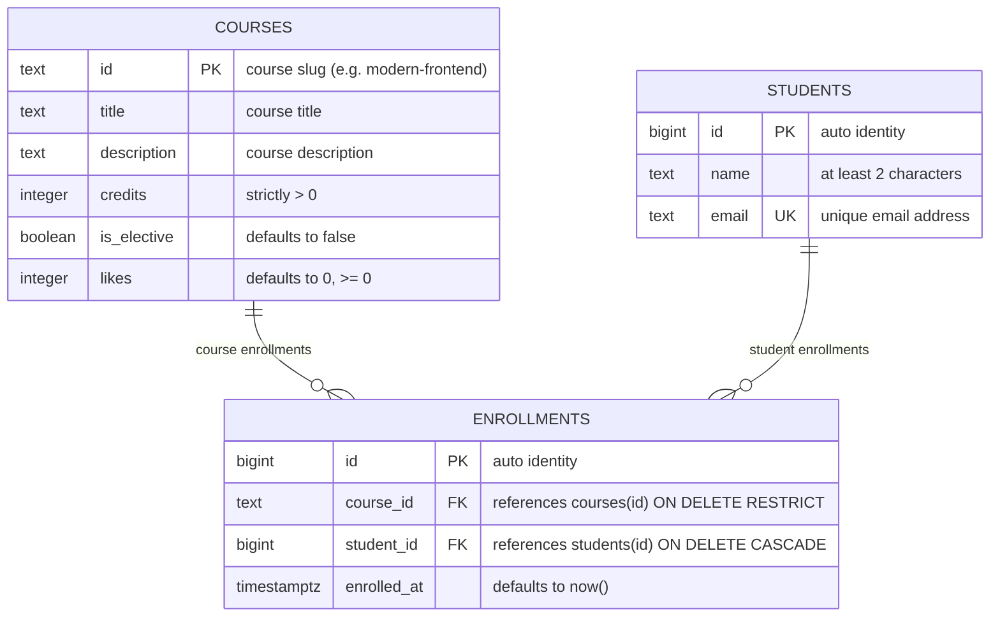

# Course Catalog Database (Lab 6)

**Students / Team:** Новиков Максим, Сартов Даурен, Арыстамбаева Жанель, Ханов Алишер, Сабекова Томирис  
**Group:** IT3-2304  
**Course:** Advanced Web Technologies · Lab 6: PostgreSQL Database Schema

PostgreSQL schema and query design for the Course Catalog application, migrating from in-memory structures to a fully normalized relational database with declarative integrity constraints, foreign keys, indexes, and transactions.

---

## How to run

PostgreSQL 16 or newer is required. Once, as the `postgres` superuser:
```sql
CREATE ROLE catalog_app LOGIN PASSWORD 'change-me';
CREATE DATABASE course_catalog OWNER catalog_app;
CREATE DATABASE idx_demo OWNER catalog_app;
CREATE DATABASE norm_demo OWNER catalog_app;
```

Then, from the project folder (it stops at the first error):
```bash
psql -h localhost -U catalog_app -d course_catalog -v ON_ERROR_STOP=1 -f schema.sql
psql -h localhost -U catalog_app -d course_catalog -v ON_ERROR_STOP=1 -f seed.sql
psql -h localhost -U catalog_app -d course_catalog -v ON_ERROR_STOP=1 -f queries.sql
```

The password `change-me` is for teaching; real projects keep passwords out of git.

---

## Schema



The schema models courses and students connected in a classic many-to-many relationship via the `enrollments` junction table. Each enrollment links exactly one course to one student (`||--o{`), while the composite unique constraint `UNIQUE (course_id, student_id)` prevents duplicate enrollments. Referential integrity is strictly maintained through foreign keys with deliberate deletion semantics (`RESTRICT` for courses, `CASCADE` for students).

---

## Design decisions

- **Why `courses.id` is `text` (a slug) while `students.id` is an automatic number (`bigint`):**
  - `courses.id` as a slug (`text`, e.g. `'modern-frontend'`): Natural, human-readable identifier that produces clean, semantic URLs in frontend routing (`/courses/modern-frontend`). It simplifies API route parameters and avoids unnecessary joins when rendering links. Since courses are curated offerings, course slugs are stable and rarely mutate.
  - `students.id` as surrogate key (`bigint GENERATED ALWAYS AS IDENTITY`): Surrogate integer keys provide compact, fixed-size 8-byte identifiers that yield fast indexing and optimal foreign-key performance. Student email addresses and personal details can change over time; decoupling immutable primary keys from mutable user profile attributes avoids cascade updates throughout the system.
- **Why `RESTRICT` on `enrollments.course_id` but `CASCADE` on `enrollments.student_id`:**
  - `RESTRICT` on `course_id`: Courses represent institutional catalog assets. Deleting a course that has enrolled students would silently corrupt student academic records and course histories. Blocking deletion (`RESTRICT`) forces administrators to resolve active student enrollments prior to decommissioning an offering.
  - `CASCADE` on `student_id`: Enrollments are owned by student accounts. When a student account is removed (e.g. deregistration or GDPR compliance), their associated enrollment records should be automatically cleaned up without leaving dangling orphaned rows.
- **Why `timestamptz` and not `timestamp`, and why `text` and not `varchar(n)`:**
  - `timestamptz` (`timestamp with time zone`): Stores moments in time converted to UTC internally. This eliminates ambiguity when querying across client browsers in different time zones, server migrations, or daylight saving transitions. In contrast, plain `timestamp` discards timezone offset information.
  - `text` vs `varchar(n)`: In PostgreSQL, `text` and `varchar` use the exact same underlying binary storage structure (`varlena`) and offer identical performance. Arbitrary character limits (`varchar(255)`) are obsolete conventions from other engines. Domain-specific constraints (e.g. `char_length(name) >= 2`) are enforced via declarative `CHECK` constraints, providing precise business rule validation.

---

## Constraint violation log

All error tests were executed in `psql` with `\set VERBOSITY verbose` to inspect SQLSTATE error codes and constraint identifiers.

| # | What we violate | SQLSTATE | Constraint / Column | API response |
|---|-----------------|----------|---------------------|--------------|
| 1 | NULL in `courses.title` | `23502` | `title` (column) | `422 Unprocessable Entity` (or `500` if Pydantic let an invalid payload through) |
| 2 | `courses.credits = 0` | `23514` | `courses_credits_check` | `422 Unprocessable Entity` |
| 3 | `courses.likes = -1` | `23514` | `courses_likes_check` | `500 Internal Server Error` (only backend increments counter; negative value is a server bug) |
| 4 | One-letter student name (`'A'`) | `23514` | `students_name_check` | `422 Unprocessable Entity` |
| 5 | Duplicate student email (`'zhanel@example.com'`) | `23505` | `students_email_key` | `409 Conflict` |
| 6 | Duplicate course ID (`'api-design'`) | `23505` | `courses_pkey` | `409 Conflict` |
| 7 | Repeated enrollment in same course | `23505` | `enrollments_course_id_student_id_key` | `409 Conflict` |
| 8 | Enrolling in nonexistent course | `23503` | `enrollments_course_id_fkey` | `404 Not Found` (course not found) |
| 9 | Enrolling nonexistent student | `23503` | `enrollments_student_id_fkey` | `404 Not Found` (student not found) |
| 10 | Deleting course that has enrollments | `23001` | `enrollments_course_id_fkey` (RESTRICT) | `409 Conflict` (course cannot be deleted while enrollments exist) |
| 11 | Deleting student with enrollments (`'dauren@example.com'`) | None (success) | `enrollments_student_id_fkey` (CASCADE) | `204 No Content` / `200 OK` (cascading delete removed enrollments: 6 → 3; rolled back) |

### Why validate in the database if Pydantic already validates in code?
Pydantic only validates inputs entering through one specific API gateway process. The database is the authoritative single source of truth and the final line of defense for the entire system. In production environments, data can be inserted, modified, or migrated through multiple pathways outside of the web API: background workers, CLI administrative commands, batch data import scripts (ETL), direct database migrations, or other backend microservices. Database-level constraints ensure that business rules, relational integrity, and invariants are unconditionally preserved across the board, even if application code contains bugs or is bypassed completely.

---

## Index: EXPLAIN before and after

Query: `SELECT * FROM enrollments WHERE student_id = 777;`  
Database `idx_demo`: 500 courses, 20,000 students, 50,000 enrollments.

| Metric | Before the index | After the index |
|---|---|---|
| Access method | `Seq Scan on enrollments` | `Bitmap Heap Scan` via `Bitmap Index Scan on enrollments_student_id_idx` |
| Cost estimate | `0.00..1042.00` | `4.31..15.59` |
| Rows Removed by Filter | `49997` | `0` |
| Execution Time | `3.361 ms` | `0.006 ms` (~560× faster) |
| Storage footprint | Table size: `3336 kB` | Index size: `896 kB` (~26.8% table size overhead) |

### Plan before index (`Seq Scan`):
```text
Seq Scan on enrollments  (cost=0.00..1042.00 rows=3 width=34) (actual time=0.067..3.348 rows=3.00 loops=1)
  Filter: (student_id = 777)
  Rows Removed by Filter: 49997
  Buffers: shared hit=417
Planning Time: 0.062 ms
Execution Time: 3.361 ms
```

### Plan after index (`Bitmap Index Scan`):
```text
Bitmap Heap Scan on enrollments  (cost=4.31..15.59 rows=3 width=34) (actual time=0.003..0.004 rows=3.00 loops=1)
  Recheck Cond: (student_id = 777)
  Heap Blocks: exact=3
  Buffers: shared hit=5
  ->  Bitmap Index Scan on enrollments_student_id_idx  (cost=0.00..4.31 rows=3 width=0) (actual time=0.001..0.002 rows=3.00 loops=1)
        Index Cond: (student_id = 777)
        Index Searches: 1
        Buffers: shared hit=2
Planning Time: 0.008 ms
Execution Time: 0.006 ms
```

### Answers to Questions:
1. **Why didn't PostgreSQL create an index on `enrollments.student_id`, although there are indexes on `email` and `course_id`?**  
   PostgreSQL automatically generates B-tree indexes only for `PRIMARY KEY` and `UNIQUE` constraints (e.g. `students_email_key` from `UNIQUE (email)` and `enrollments_course_id_student_id_key` from composite unique). It does *not* automatically build indexes on `FOREIGN KEY` columns. Furthermore, composite indexes can only be utilized from left-to-right (leading prefix); because `course_id` is the leading column in `(course_id, student_id)`, lookups filtering solely by `student_id` cannot use that composite index.
2. **Why does a primary-key lookup on `courses` (6 rows) use `Seq Scan`, while on `enrollments` (50,000 rows) it goes through an index?**  
   The cost-based query planner compares estimated I/O and CPU costs. For a small 6-row table, the whole relation fits in a single memory/disk block, so reading the single page (`cost=1.07`) is faster than reading an index page plus a heap page. For a 50,000-row table spanning hundreds of blocks, `Seq Scan` requires scanning every single block (`cost=1042.00`), whereas traversing the index tree and reading only 3 matching heap blocks costs only `~15.59`.
3. **Name two operations that an index on `student_id` will speed up:**  
   - Fetching all courses/enrollments for a specific student (`SELECT * FROM enrollments WHERE student_id = $1` or queries joining on student ID).
   - Performing cascading deletes when removing a student (`DELETE FROM students WHERE id = $1` with `ON DELETE CASCADE`), allowing PostgreSQL to instantly locate and remove child records without doing a full sequential table scan.

---

## Transaction

Scenario: enrolling a new student in a course — atomic execution of two inserts within a single database transaction.

### 1. Second insert failure & aborted transaction state
When the second statement (`INSERT INTO enrollments ...`) attempted to reference nonexistent course `'no-such-course'`, PostgreSQL raised a foreign key violation:
```text
ERROR:  insert or update on table "enrollments" violates foreign key constraint "enrollments_course_id_fkey"
DETAIL:  Key (course_id)=(no-such-course) is not present in table "courses".
```
- Following this error, the transaction entered the **aborted state** (`=*>` changed to `=!>`). Any subsequent commands were rejected:
  ```text
  ERROR:  current transaction is aborted, commands ignored until end of transaction block
  ```
- Executing `ROLLBACK;` terminated the transaction and completely discarded the uncommitted changes from the first insert (`INSERT INTO students`). A verification query `SELECT count(*) FROM students WHERE email = 'tomiris@example.com';` returned `0`.

### 2. Multi-client isolation observation (`READ COMMITTED`)
Simulating two concurrent database sessions:
- **Window A (Actor):** Opened a transaction (`BEGIN;`), inserted student Томирис Сабекова (`'tomiris@example.com'`), and inserted the enrollment in `'web-security'`.
- **Window B (Observer):** Ran `SELECT count(*) FROM students WHERE email = 'tomiris@example.com';` and received `0`. Because PostgreSQL operates at `READ COMMITTED` isolation by default, dirty uncommitted writes made by Window A remained completely isolated and invisible to Window B.
- **Window A:** Issued `COMMIT;`.
- **Window B:** Immediately re-ran the count query and received `1`. Both the student record and the enrollment record became atomically visible simultaneously.

### 3. What would happen without a transaction?
If the operation ran without a transaction (autocommit mode) and the second insert failed:
- The student record `Томирис Сабекова` would remain permanently stored in the `students` table.
- The enrollment insert would fail, leaving an orphaned student registered in the system with zero course enrollments.
- This creates partial-write corruption, inconsistent application states, and violates the ACID property of Atomicity ("all or nothing").

---

## Self-review against the checklist

| What to check | Result | Comment |
|---------------|--------|---------|
| **Keys** | Yes | All tables have explicit primary keys (`courses.id`, `students.id`, `enrollments.id`). Relationships are enforced via foreign keys with explicit constraints. |
| **Types** | Yes | `bigint` used for scalable identity sequences; `timestamptz` for UTC timestamps; `boolean` for flags; `integer` for credits/likes; `text` for string payloads. |
| **Required values** | Yes | All mandatory columns explicitly marked `NOT NULL`. Default values provided for `is_elective` (`false`), `likes` (`0`), and `enrolled_at` (`now()`). |
| **Constraints** | Yes | `CHECK (credits > 0)`, `CHECK (likes >= 0)`, `CHECK (char_length(name) >= 2)`, `UNIQUE (email)`, `CHECK (position('@' IN email) > 1)`, and `UNIQUE (course_id, student_id)`. |
| **Deletion** | Yes | `ON DELETE RESTRICT` deliberately chosen for `course_id` (preserves historical enrollments); `ON DELETE CASCADE` chosen for `student_id` (deletes registrations with profile). |
| **Normalization** | Yes | Decomposed into 3NF / BCNF. Zero duplicate student names/emails across courses. Independent lifecycle for each entity. |
| **Indexes and names** | Yes | Consistent `snake_case` naming across tables and columns. Foreign key index `enrollments_student_id_idx` created for fast joins and cascades. |

---

## Bonus Tasks

### Task 1. Normalization: Three Anomalies of a Flat Table
Using the flat `registrations` table in `norm_demo` (`experiments/norm_demo.sql`):
1. **Update Anomaly:** Renaming a course in a single row caused `modern-frontend` to simultaneously display two conflicting titles (`Modern Frontend: React & Next.js` and `Modern Frontend: React 19 & Next.js 16`). Updating a fact requires updating $N$ duplicate rows; missing any row causes data corruption.
2. **Delete Anomaly:** When Даурен Сартов's enrollment in `backend-fastapi` was deleted, the entire course information was completely deleted from the database because it existed only inside that registration row.
3. **Insert Anomaly:** Adding a new course (`web-security`) with zero students required inserting a row with an empty/NULL student name and email.
- **Solution:** Splitting the entity models into 3 normalized tables (`courses`, `students`, and the junction table `enrollments`) isolates distinct domain entities. A course title is stored exactly once; courses exist independently of enrollments; students exist independently of enrollments.

### Task 2. Lost Update and Row Locking
In concurrent web applications, executing "read $\to$ calculate in Python $\to$ write back" creates a race condition:
- If Window A reads `likes = 11` and Window B reads `likes = 11`, both independently compute `12` and write `UPDATE courses SET likes = 12`. Result: one like is permanently lost.
- In contrast, `UPDATE courses SET likes = likes + 1 WHERE id = 'api-design' RETURNING likes;` executes atomically on the server.
- Furthermore, when Window A executes the update inside an open transaction (`BEGIN;`), PostgreSQL acquires an **exclusive row-level lock** (`FOR UPDATE`) on the `api-design` row. When Window B attempts to update the same row, its query is suspended and waits until Window A executes `COMMIT;`. Upon release, Window B re-evaluates the fresh value (`12`) and safely increments it to `13`.

### Task 3. Parameters vs String Concatenation: SQL Injection
- When an identifier `'x'' OR ''1''=''1'` is concatenated directly into the SQL string (`WHERE id = 'x' OR '1'='1'`), the Boolean predicate evaluates to `TRUE` for every row, leaking all catalog courses.
- When parameterized with prepared statements:
  ```sql
  PREPARE by_id (text) AS SELECT id, title FROM courses WHERE id = $1;
  EXECUTE by_id('x'' OR ''1''=''1');
  ```
  PostgreSQL parses the SQL grammar and AST *before* evaluating parameters. The parameter `$1` is treated strictly as an atomic scalar literal string rather than executable SQL tokens. Since no course ID literally equals `x' OR '1'='1'`, the query safely returns 0 rows.

### Task 4. Additional Queries (Queries 7 and 8)
Appended to `queries.sql`:
- **Query 7 (Courses without enrollments):**
  Uses `LEFT JOIN enrollments e ON e.course_id = c.id WHERE e.id IS NULL ORDER BY c.id;`.  
  Result: 3 rows (`api-design`, `databases-postgresql`, `web-security`).
- **Query 8 (Students in multiple courses):**
  Uses `GROUP BY s.id, s.name HAVING count(*) > 1 ORDER BY courses DESC, s.name;`.  
  Result: 2 rows:
  ```text
          name         | courses 
  ---------------------+---------
   Даурен Сартов       |       3
   Жанель Арыстамбаева |       2
  ```

### Task 5. Schema Evolution with ALTER TABLE
Demonstrated live constraint addition without data loss:
```sql
ALTER TABLE students ADD CONSTRAINT students_email_format CHECK (position('@' IN email) > 1);
```
Attempting to insert an invalid email `'no-at-sign'` immediately triggered:
```text
ERROR:  new row for relation "students" violates check constraint "students_email_format"
DETAIL:  Failing row contains (4, Test User, no-at-sign).
```
The constraint was subsequently added to `CREATE TABLE students` in `schema.sql`.
